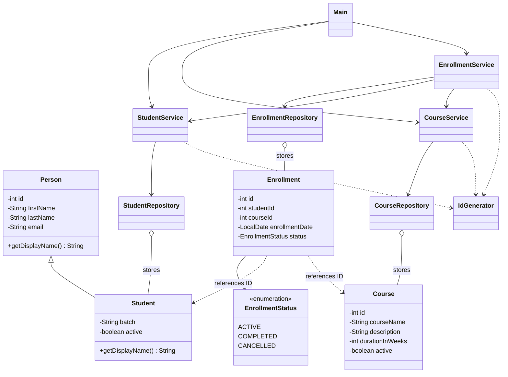

# LearnTrack — Student & Course Management System

LearnTrack is a menu-driven, in-memory **Core Java** console application for managing students, courses and enrollments. It demonstrates encapsulation, inheritance, overriding, overloaded constructors/methods, `static` members, `ArrayList`, packages and exception handling. **No database or external libraries are required.**

## Requirements
- **JDK 21** (the project was built and verified using OpenJDK 21). Basic Java features also work on older modern JDKs.
- A terminal or IntelliJ IDEA.

## Compile and run
From the project root:

**macOS/Linux:**
```bash
mkdir -p out
javac -d out $(find src -name "*.java")
java -cp out com.airtribe.learntrack.Main
```

**Windows PowerShell:**
```powershell
New-Item -ItemType Directory -Force out | Out-Null
Get-ChildItem -Recurse src -Filter *.java | ForEach-Object FullName | Set-Content sources.txt
javac -d out '@sources.txt'
java -cp out com.airtribe.learntrack.Main
Remove-Item sources.txt
```

**IntelliJ IDEA:** Open the `LearnTrack` folder as a project → configure Project SDK to JDK 21 → right-click `src` and choose **Mark Directory as → Sources Root** if needed → open `src/com/airtribe/learntrack/Main.java` → click the green Run icon beside `main()`.

## How to use
1. Select **1 (Students)** to add a student. IDs start at **1001**.
2. Select **2 (Courses)** to add a course. IDs start at **2001**.
3. Select **3 (Enrollments)** to enroll an active student in an active course. IDs start at **3001**.
4. View enrollments by student ID, and complete or cancel an active enrollment by enrollment ID.
5. Enter **0** on the main menu to exit.

Data is stored in `ArrayList`s and **resets each time you restart the program**. Student deactivation is a soft removal: historical enrollment records remain. A student cannot have two **active** enrollments in the same course; a completed/cancelled enrollment may be followed by a new one.

## Class diagram



## Structure
```text
LearnTrack/
├── README.md
├── .gitignore
├── docs/
│   ├── Setup_Instructions.md
│   ├── JVM_Basics.md
│   └── Design_Notes.md
└── src/com/airtribe/learntrack/
    ├── Main.java
    ├── entity/       Person, Student, Course, Enrollment
    ├── repository/   StudentRepository, CourseRepository, EnrollmentRepository
    ├── service/      StudentService, CourseService, EnrollmentService
    ├── exception/    EntityNotFoundException, InvalidInputException
    ├── util/         IdGenerator, InputValidator
    ├── enums/        EnrollmentStatus
    └── constants/    MenuOptions, AppConstants
```

## Design and documentation
See [setup instructions](docs/Setup_Instructions.md), [JVM basics](docs/JVM_Basics.md) and [design notes](docs/Design_Notes.md).

## Submission
Make the repository **public**, commit your files, and create a **pull request** (typically from a `submission` branch into `main` of your own repository, unless the course provides a starter/upstream repository). Submit **both the public GitHub repository URL and the PR URL** through the course's assignment submission page. **Do not merge the PR unless your instructor asks you to.**
